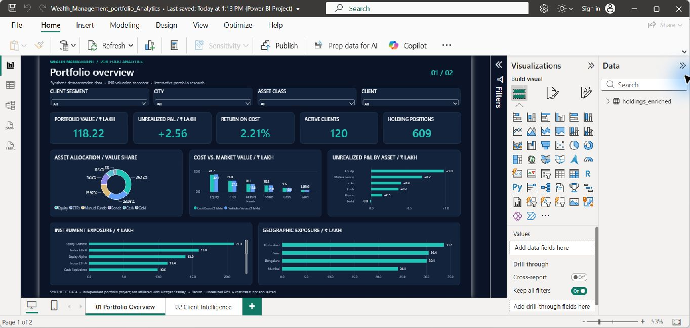
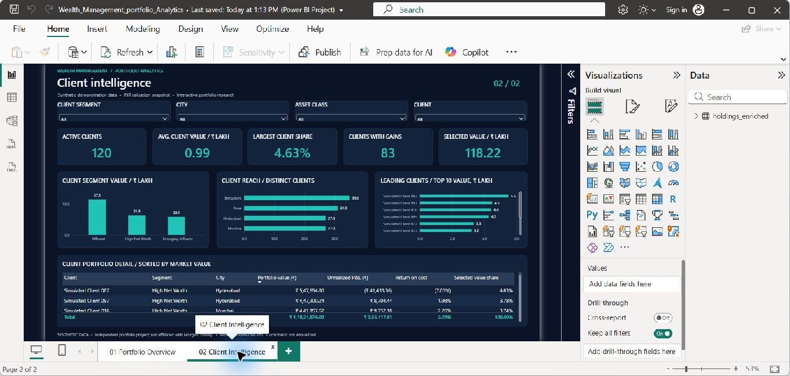

# Wealth Management Portfolio Analytics

An independent, two-page Power BI portfolio project for exploring valuation, asset allocation, unrealized gains and client concentration. Built with **Power BI, DAX, Power Query, SQL and Python** using explicitly synthetic data.

> Personal portfolio project. Not affiliated with, endorsed by, or delivered for Morgan Stanley or any financial institution. No real client or investment-account data is used.

## Report previews

### Portfolio Overview



Five KPI cards summarize portfolio value, unrealized P&L, return on cost, distinct clients and holding positions. Charts compare asset allocation, cost versus value, P&L by asset, instrument exposure and geographic exposure.

### Client Intelligence



Client analysis includes segment value, geographic reach, leading clients, average client value, largest-client share and a detailed client table. Segment, city, asset-class and client slicers are available on both pages. Slicer selections are independent between pages.

## Dataset and baseline

The report uses a 609-row enriched holdings snapshot covering 120 fictional clients, 12 instruments, six asset classes, three client segments and four cities. The source price snapshot is **31 October 2026**. All monetary values are INR; chart/card labels marked **lakh** divide INR by 100,000.

| Metric | Unfiltered result |
| --- | ---: |
| Portfolio market value | ₹11,821,876.03 |
| Cost basis | ₹11,565,758.22 |
| Unrealized P&L | ₹256,117.81 |
| Return on cost | 2.2144% |
| Distinct clients | 120 |
| Holding positions | 609 |
| Largest-client share | 4.6326% |
| Clients with net unrealized gains | 83 |

These figures describe the synthetic dataset, not real assets managed or investment results.

## Open in Power BI Desktop

1. Download or clone the entire repository onto Windows.
2. Open `Wealth_Management_portfolio_Analytics.pbip` in a Power BI Desktop version that supports PBIP/PBIR and TMDL.
3. The repository intentionally excludes the local data cache. Before refreshing, set the CSV source to your local `data/holdings_enriched.csv`. The default source is `C:\wealth-management-portfolio-analytics\data\holdings_enriched.csv`.
4. If you cloned elsewhere, use **Transform data → Data source settings → Change Source** to select that file. Then apply changes and **Refresh**.
5. Explore the two page tabs. Return slicers to **All** for the baseline results above.

Local Desktop use does not require publishing to the Power BI service. GitHub displays source files and screenshots; it does not run the interactive report. A `.pbix` binary is not included in this source repository.

## Reproduce the synthetic data and analysis

Python scripts use the standard library only. Run from the repository folder:

```sh
python generate_data.py
python analyze.py
python build_dataset.py
python validate.py
```

`generate_data.py` uses a fixed random seed and writes fictional client, instrument, holding and price CSVs. `analyze.py` rebuilds a local SQLite database and executes the four queries in `queries.sql`. `build_dataset.py` joins clients and instruments to holdings and selects the 2026-10-31 price snapshot, avoiding duplicate valuation across price dates. `validate.py` checks row identities and reconciles totals and filter examples against the checked-in expectations.

The synthetic generator and SQL analysis originate from the project's supplied FinTech analytics starter. This repository brings those sources together with the Power BI report, model, enrichment script and validation workflow.

## Measure definitions

The model contains 15 DAX measures; review [Measures.dax](Measures.dax) or the TMDL table definition.

- **Portfolio value:** sum of holding market values.
- **Unrealized P&L:** sum of market value minus cost basis.
- **Return on cost:** total P&L divided by total cost, using `DIVIDE`; no average of holding-level percentages.
- **Average client value:** selected portfolio value divided by distinct selected clients.
- **Largest-client share:** largest selected client value divided by the selected portfolio total.
- **Allocation share:** category/client value divided by the selected total, preserving slicer selections with `ALLSELECTED`.
- **Leading clients:** first ten value ranks within selected clients; ties may include more than ten clients.

This is a valuation snapshot. Return on cost is not annualized, time-weighted or money-weighted performance. The report does not claim benchmark alpha, Sharpe ratios or risk-adjusted returns. The starter's historical price rows are not used to fabricate historical portfolio performance.

## Validation

- All 609 unique holdings reconcile to units × price and units × average cost within INR 0.000001.
- Portfolio totals reconcile to asset-class, client-segment and city subtotals.
- Both report pages were opened, refreshed and visually checked in Power BI Desktop.
- Unfiltered KPIs matched independent CSV calculations at displayed precision.
- **Affluent + Equity** produced 37 clients, ₹2,288,370.76 in value, ₹116,152.18 in unrealized P&L and 5.3472% return on cost.
- The segment and asset slicers were exercised together. City and client slicers are bound to their source fields but were not separately exercised during this review.

See [expected results](validation/expected_results.json) and run `python validate.py`. These checks cover representative filter contexts, not every possible combination. After cloning, update the source path and refresh your own Desktop copy.

## Repository contents

```text
Wealth_Management_portfolio_Analytics.pbip
Wealth_Management_portfolio_Analytics.Report/         # Report pages, visuals and theme
Wealth_Management_portfolio_Analytics.SemanticModel/  # TMDL model and DAX
data/                                                # Synthetic source and enriched CSVs
screenshots/                                         # Actual Power BI Desktop previews
validation/                                          # Reconciliation expectations
generate_data.py
analyze.py
build_dataset.py
validate.py
queries.sql
Measures.dax
```

## Limitations

Single-machine local CSV refresh; no scheduled service refresh, live market feed or row-level security is configured. Screenshots are static previews. Nothing is published to Power BI service as part of this repository.
